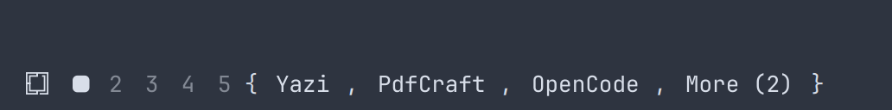
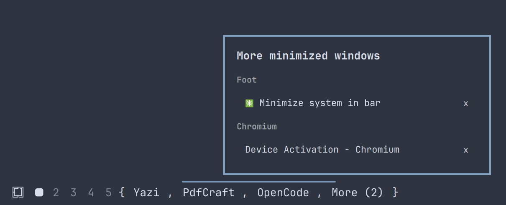

# Minimized Windows for Omarchy

Minimize windows in Hyprland and get them back from the Omarchy bar.

Minimized windows show up in the bar wrapped in braces, one button per app:



Apps with several windows, and the apps past the first three (**More**), open a
list:



- Click an app with one window to restore it. Right-click to close it.
- Click an app with several windows, or **More**, to open a list. In the list,
  click a window to restore it, or click the **x** on its right to close it.
- Each workspace has its own minimized windows. The bar only shows the ones
  minimized from the workspace you're on, and they come back to it.
- Terminal apps that set a recognizable window title, like Yazi, get their own
  button instead of being grouped with the terminal.

## Install

```bash
omarchy plugin add https://github.com/HnD-VXD/omarchy-minimize.git --enable
```

Then add the keybindings (see below).

## Keybindings

Omarchy plugins can't add Hyprland keybindings themselves, so the plugin ships
a script that adds them to `~/.config/hypr/bindings.lua`:

```bash
bash ~/.config/omarchy/plugins/io.github.hnd-vxd.minimize/scripts/install-keybindings.sh
```

| Keys | Action |
|---|---|
| `SUPER + H` | Minimize the focused window |
| `SUPER + SHIFT + H` | Minimize every other window on the workspace |
| `SUPER + ALT + H` | Restore every window minimized from the workspace |
| `SUPER` + right-click | Minimize the window under the cursor |
| `SUPER` + left-click | Minimize every other window |

The mouse bindings only fire on a click without movement. Dragging with `SUPER`
still moves (left button) or resizes (right button) windows as usual: the
script sets Hyprland's `binds.drag_threshold` to 10 pixels so the two can be
told apart.

The bindings sit in one marked block, so running the script again replaces it.
To take them out:

```bash
bash ~/.config/omarchy/plugins/io.github.hnd-vxd.minimize/scripts/install-keybindings.sh --remove
```

Prefer to add them by hand? Copy the lines from
[`keybindings.lua`](keybindings.lua) into `~/.config/hypr/bindings.lua`.

## How it works

Minimizing moves a window to a hidden special workspace named
`special:minimized-<workspace>`. The bar widget lists the windows on the hidden
workspace for the workspace you're on. Restoring moves the window back and
focuses it.

## Requirements

- Omarchy with the Quickshell-based bar (Omarchy Quattro)
- `hyprctl` and `jq` (both come with Omarchy)

## Uninstall

```bash
bash ~/.config/omarchy/plugins/io.github.hnd-vxd.minimize/scripts/install-keybindings.sh --remove
omarchy plugin remove io.github.hnd-vxd.minimize
```

Restore any minimized windows first (`SUPER + ALT + H`), or they stay on the
hidden workspace until you move them back.

## License

MIT
